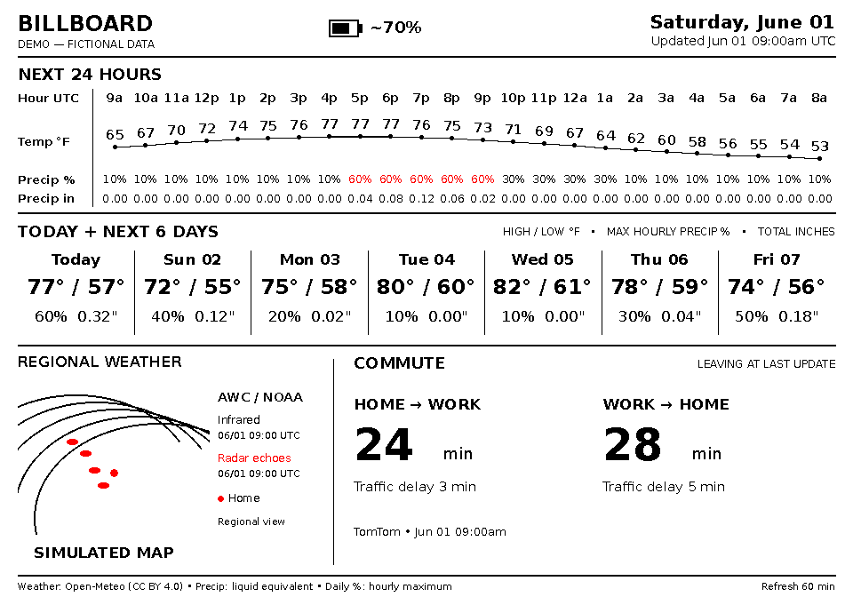

# Billboard Dashboard

A self-hosted, battery-friendly dashboard for the **Hackaday Billboard Badge**:
a 960 × 672 black/white/red e-paper display with an ESP32-S3.

The server fetches data and renders the complete image. The badge wakes, downloads
it over authenticated HTTPS, refreshes the panel if it changed, and sleeps.
Home Assistant is not required. This is an independent community project, not an
official Hackaday release.



*This screenshot uses fictional forecasts, travel times and map artwork. It does
not contain a real installation's location, observations or credentials.*

## What it does

- Current hour plus the next 23 hourly forecasts, and today plus six daily forecasts.
- Temperature, precipitation probability and liquid-equivalent precipitation.
- Optional regional Aviation Weather Center infrared imagery and radar echoes,
  recolored for the three-color panel, with a dot at your configured location.
- Optional TomTom travel times in both directions between two configured points.
- Approximate battery meter; red at 20% or below.
- Hourly deep sleep by default, with manual refresh via a button.
- TLS server verification, individual device credentials, a separate browser login,
  bounded request handling and container network isolation.

The current release has one dashboard page. The manifest and button navigation
allow future pages; there is no page editor or per-screen battery rendering yet.
Units are currently °F, inches and minutes. AWC radar coverage is primarily useful
in the United States; Open-Meteo weather can be used elsewhere with the map disabled.

## Requirements

**Server:** Linux, Docker Engine 28+ with the iptables firewall backend, Docker
Compose v2, Python 3.10+ and OpenSSL for setup. The isolated Docker bridges and the
optional host firewall instructions target native Linux Docker, not rootless
Docker or Docker Desktop. No public Internet-facing port or domain is needed.

**Badge:** the ESP32-S3 Billboard Badge hardware described by the
[upstream project](https://github.com/Hack-a-Day/2026-Billboard_Badge), with 8 MB
flash and 8 MB octal PSRAM. Firmware is C, built with ESP-IDF 5.4. Other displays
or badge revisions may require driver/pin changes.

## Quick start

Clone this repository onto your server or provisioning computer:

```sh
git clone https://github.com/aerospace-venoms/billboard-dashboard.git
cd billboard-dashboard
python3 scripts/setup.py
```

The wizard asks for the server's **LAN IPv4 address**, allowed client addresses
or subnets (include the badge), coordinates, timezone and optional commute. Wi-Fi
credentials are entered locally; the password is not echoed. You can leave Wi-Fi
blank and edit the ignored `firmware/main/private_config.h` later.

It creates `.env`, fresh TLS certificates, separate random badge/viewer credentials,
an empty TomTom key file, an nginx allowlist and private firmware configuration.
It refuses to overwrite an existing installation. `.env.example` documents the
settings; it is not a usable production location configuration.

On the **Docker host**, prepare file ownership and start the services:

```sh
sudo scripts/install-permissions.sh
docker compose up -d --build
docker compose ps
```

Allow TCP **8090** from your viewing devices and badge to the server in your router
firewall. Allow the badge to use DNS and NTP (`pool.ntp.org`, UDP 123 by default).
Do not forward the dashboard port from the public Internet.

Import `generated/dashboard-ca.crt` into your browser's trusted certificate
authorities, open the HTTPS URL printed in `secrets/viewer-login.txt`, and use the
login in that file. Do not bypass certificate errors or send credentials over HTTP.
Weather may take a minute to appear. The Docker health check becomes healthy once
current weather is available; a missing TomTom key does not fail health.

Read [security and deployment](docs/security.md) to install the additional host
firewall rules, understand the trust boundaries, and maintain credentials and
certificates. **Those host rules are not installed automatically.** Without them,
the renderer is isolated but the frontend/egress containers are less restricted
if compromised.

### Separate server and provisioning computer

Keep the CA private key, plaintext viewer password and raw badge token on your
provisioning computer. Transfer the repository plus `.env`,
`generated/allowed-clients.conf`, `generated/dashboard-ca.crt`,
`secrets/auth.json`, `secrets/tomtom_key`, and `secrets/tls/server.{crt,key}` to the
server. Run the permissions script there. Do not transfer the entire `secrets/`
directory or build tree. See [firmware instructions](firmware/README.md) to flash
from the computer connected to the badge.

### Optional traffic

Obtain your own [TomTom Routing API key](https://developer.tomtom.com/). Account
requirements and quotas are controlled by TomTom; review their current terms.
Set both destination coordinates during setup (or edit `WORK_LAT`/`WORK_LON` in
`.env`). On the Docker host, edit the key file without putting the key on the
command line:

```sh
sudoedit secrets/tomtom_key
sudo scripts/install-permissions.sh
docker compose up -d --force-recreate dashboard frontend
```

With no destination, commute is disabled. With a destination but no key, it shows
“Awaiting API key”. Two routes are fetched each refresh, approximately 1,500
requests per month at an hourly interval, plus restarts. **No API key is bundled.**

### Firmware

Follow [firmware/README.md](firmware/README.md). Flashing replaces the installed
badge firmware: preserve your original firmware yourself before doing so.

The **B button (GPIO16)** is verified for manual refresh. GPIO15 (upstream Menu+)
is also configured as a deep-sleep wake source. With one page, both check for an
update; with more pages they navigate. Other buttons are not deep-sleep wake
sources in this firmware. Board labels can differ; verify your hardware.

## Data semantics and limitations

- Hourly weather starts at the current hour. Epoch timestamps preserve 24 elapsed
  hours across DST: spring skips the missing hour, fall repeats the extra hour.
- Daily weather is local-calendar today plus six days. Daily probability is the
  maximum hourly probability, not a probability calculated for the whole day.
- Precipitation amounts follow Open-Meteo's preceding-hour convention. Missing
  values are shown as missing rather than zero; stale data is marked.
- Black stippling on the map represents infrared brightness; red represents radar
  echoes, not necessarily surface rain or a quantitative precipitation intensity.
  The red dot indicates the configured location. Low-resolution coast outlines
  come from Natural Earth. AWC image-tile endpoints are used by its public website,
  not guaranteed by its documented data API, and may change.
- Commutes mean “leave at the last fetch time”, not an arrival-time prediction.
  Old traffic estimates are not reused after a failed fetch.
- The badge's voltage divider senses regulator input. USB power masks battery
  voltage, so the meter shows USB instead of a charge percentage. The LiPo curve
  is a generic approximation; it is not a fuel gauge or battery safety circuit.
- Battery life depends on the board's standby current, battery, Wi-Fi and refresh
  rate. Multi-month runtime has **not** been measured or established.
- A second device can have its own token, but both currently see the latest
  accepted battery sample. Per-device rendering is future work.

## Development and offline demo

On Debian/Ubuntu, install `python3-venv`, `fonts-dejavu-core` and `openssl`, then:

```sh
python3 -m venv .venv
.venv/bin/pip install -r requirements.txt
.venv/bin/python -m unittest discover -s tests -v
.venv/bin/python scripts/demo.py
```

Tests use fixtures and temporary credentials. The demo generator does not fetch
live data or read a deployment's `.env`/credentials. CI tests the server and builds
firmware with disposable, nonfunctional Wi-Fi settings; it never publishes firmware
binaries. To build the server image: `docker build -t billboard-dashboard .`.

See [protocol](docs/protocol.md) for the manifest and packed frame format. Use
`docker compose logs --tail 50` for diagnostics. `docker compose down` preserves
the data volume; do not use `-v` unless you intend to delete cached data.

## Licensing and attribution

Original project code is released under the [Unlicense](LICENSE). The vendored
badge display driver is **BSD-2-Clause**, including the Pervasive Displays notices
in its [license](firmware/components/billboard_epd/LICENSE). Third-party components
retain their own licenses; the Unlicense does not override those.

[Third-party notices](docs/third-party.md) cover the driver, map data and external
services. Public software does not grant redistribution rights to your personal
configuration, provider credentials or every provider's downloaded content.
